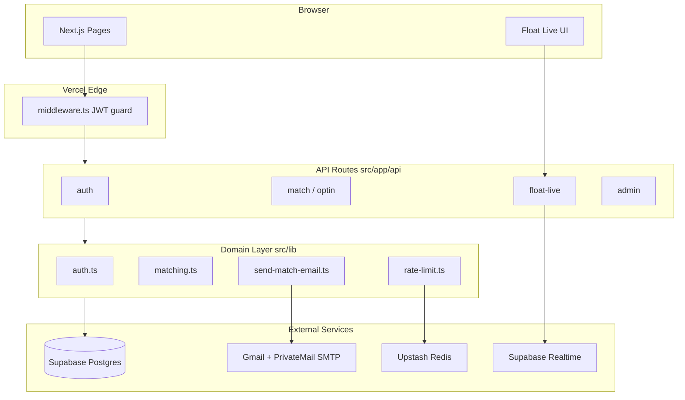

# FloatDate

A full-stack university dating platform that matches students weekly based on a psychology-backed compatibility quiz, with real-time blind-date chat (Float Live), admin tooling, and campus-specific onboarding.

Built as a production Next.js monolith deployed on Vercel with Supabase Postgres.

---

## Problem

Campus dating apps optimize for volume, not compatibility. FloatDate takes the opposite approach: students complete a structured 60-question quiz once, opt in weekly, and receive one curated match per cycle with an explanation of why they were paired — scoped to their university.

---

## Features

| Area | What it does |
|------|----------------|
| **Onboarding** | University email verification, optional document verification for Gmail signups, referral program |
| **Compatibility quiz** | 60 weighted questions across attachment, values, lifestyle, communication, and interests |
| **Weekly matching** | Opt-in by Tuesday 9 PM ET; blossom algorithm pairs users within university + gender/city constraints |
| **Match emails** | Compatibility score, explanation, and partner profile delivered via SMTP |
| **Dashboard** | Opt-in toggle, current match, feedback collection, profile editing |
| **Float Live** | Scheduled real-time blind-date sessions with pixel-art UI, chat, optional voice/WebRTC, email reveal |
| **Float Pop or Match** | Campus show application / waiting-list feature |
| **Admin panel** | User management, verification review, matching preview/trigger, Float Live moderation, impersonation |
| **Referrals** | Invite codes with optional gate on signup |

---

## Tech Stack

| Layer | Choice | Why |
|-------|--------|-----|
| Framework | **Next.js 16** (App Router) | Single deployable unit for marketing pages, dashboard, and 69 API routes |
| UI | **React 19** + **Tailwind CSS v4** | CSS-native theming; fast iteration on glass-morphism marketing UI |
| Language | **TypeScript 5** | End-to-end type safety across API routes and Prisma models |
| Database | **PostgreSQL** via **Supabase** | Managed Postgres with connection pooling for serverless |
| ORM | **Prisma 7** + `pg` adapter | Typed schema, migrations, and query builder |
| Auth | **Custom JWT** (`jose`) + **bcrypt** | Full control over university-domain rules without Supabase Auth coupling |
| Realtime | **Supabase Realtime** | Float Live chat presence and message sync |
| Rate limiting | **Upstash Redis** | Serverless-compatible sliding-window limits; degrades gracefully if unset |
| Matching | **edmonds-blossom** + custom scoring | Stable maximum-weight matching on compatibility graphs |
| Email | **Nodemailer** (Gmail + PrivateMail SMTP) | Separate channels for match notifications vs. verification/reset |
| Validation | **Zod 4** | Request body validation on API routes |
| Testing | **Vitest** | Unit tests for matching, week cycles, and rate-limit logic |
| Deployment | **Vercel** | Zero-config Next.js hosting with cron for Float Live cleanup |

---

## Architecture



### Request flow (authenticated page)

1. Browser requests `/dashboard`
2. `middleware.ts` reads `floatdate_session` cookie, verifies JWT
3. Page fetches `/api/auth/me`, `/api/optin/status`, `/api/match/current`
4. API routes call `getCurrentUser()` → Prisma → Postgres
5. JSON response rendered client-side

### Data flow (weekly matching)

1. Users opt in via `POST /api/optin` before the Tuesday 9 PM ET deadline
2. Admin or cron calls `POST /api/admin/run-matching` with `Authorization: Bearer CRON_SECRET`
3. `runWeeklyMatching()` loads opted-in users per university, builds a compatibility graph, runs blossom algorithm
4. Matches persisted to `Match` + `MatchAttempt` tables; unmatched users identified
5. `sendMatchEmails()` / `sendNoMatchEmail()` dispatch via Gmail SMTP (if `EMAILS_ENABLED=true`)

### Data flow (Float Live session)

1. User joins via `POST /api/float-live/join` during an active session window
2. Heartbeat (`POST /api/float-live/heartbeat`) maintains presence
3. `POST /api/float-live/find-match` pairs idle participants within university
4. Chat messages sent via `POST /api/float-live/chat/send`, synced through Supabase Realtime
5. Optional email reveal via `POST /api/float-live/chat/[roomId]/reveal-email` (rate-limited)
6. Daily cron (`/api/admin/float-live/cleanup`) archives stale sessions

---

## Key Technical Decisions

| Decision | Trade-off |
|----------|-----------|
| Custom JWT auth vs. Supabase Auth | More code to maintain, but university-domain logic and impersonation are first-class |
| University-scoped matching | Smaller match pools per run, but ensures campus-relevant pairing |
| Manual matching trigger | Operator control over timing; requires `CRON_SECRET` bearer auth instead of unattended cron (weekly cron needs Vercel Pro) |
| Graceful rate-limit degradation | App works without Upstash in dev; production should always configure Redis |
| Prisma + raw `pg` pool | Works on Vercel serverless; default pool size (10) is a scaling bottleneck |
| Synchronous email in matching route | Simple implementation; long-running on large user counts |

---

## Local Development

### Prerequisites

- Node.js 20+
- PostgreSQL database (Supabase project recommended)
- Environment variables (see `.env.example`)

### Setup

```bash
git clone <repo-url>
cd floatdate
cp .env.example .env
# Edit .env with your values

npm install

# Create tables and seed 60 questions
npx tsx scripts/deploy-setup.ts

npm run dev
```

Open [http://localhost:3000](http://localhost:3000).

### Useful commands

| Command | Purpose |
|---------|---------|
| `npm run dev` | Start development server |
| `npm run build` | Production build |
| `npm run test` | Run Vitest unit tests (7 files) |
| `npm run lint` | ESLint |
| `npm run trigger-matching` | Run matching locally |
| `npm run db:dump` | Backup database |

See [docs/DEVELOPMENT.md](docs/DEVELOPMENT.md) for scripts, conventions, and owner notes.

---

## Deployment

### Infrastructure

- **Vercel** — hosts the Next.js app
- **Supabase** — Postgres database + Realtime + Storage (verification docs)
- **Upstash** — Redis rate limiting (recommended for production)
- **Gmail + PrivateMail** — SMTP for transactional email

### Steps

1. Create a Supabase project; copy the **Transaction mode** pooler URL (port 6543) as `DATABASE_URL`
2. Run `DATABASE_URL="..." npx tsx scripts/deploy-setup.ts` locally to migrate and seed
3. Import the repo to Vercel; set all variables from `.env.example`
4. Deploy; verify signup → verify → login → questions → opt-in flow
5. Trigger matching manually:

```bash
curl -X POST https://your-app.vercel.app/api/admin/run-matching \
  -H "Authorization: Bearer YOUR_CRON_SECRET"
```

### Vercel cron

[`vercel.json`](vercel.json) runs `/api/admin/float-live/cleanup` daily at 04:00 UTC. Weekly matching is triggered manually or via external cron with `CRON_SECRET`.

### Troubleshooting

- **P1001 database errors** — use the Supabase pooler URL, not the direct `db.[ref].supabase.co` hostname
- **Emails not sending** — confirm `EMAILS_ENABLED=true` (literal string) and SMTP credentials
- **PrismaClient not found** — `postinstall` runs `prisma generate` automatically

---

## Capacity

All figures below are **Estimated** from code inspection — not load-tested.

| Metric | Estimate | Basis |
|--------|----------|-------|
| Concurrent active users (browsing) | ~50–200 | Vercel serverless cold starts; `pg.Pool` default max 10 connections per instance ([`src/lib/db.ts`](src/lib/db.ts)); Supabase pooler limits |
| Float Live concurrent chatters | ~20–50 | Supabase Realtime connection limits; 1 msg/sec per-user rate limit |
| API throughput | ~100–500 req/min sustained | No caching layer; most routes hit Postgres directly |
| Weekly matching batch | ~500 opted-in users/university comfortably; degrades above ~2k | O(n²) similarity matrix + blossom in [`src/lib/matching.ts`](src/lib/matching.ts); synchronous SMTP in matching route |
| Main bottlenecks | DB connection pool, matching CPU time, synchronous email I/O, single-instance serverless | No horizontal scaling config in codebase |

---

## Documentation

| Doc | Contents |
|-----|----------|
| [docs/ARCHITECTURE.md](docs/ARCHITECTURE.md) | Components, schema, services, route map |
| [docs/SECURITY.md](docs/SECURITY.md) | Auth, validation, secrets, rate limits |
| [docs/DEVELOPMENT.md](docs/DEVELOPMENT.md) | Owner reference: scripts, testing, conventions |

---

## Roadmap

- Automated weekly matching cron on Vercel Pro
- Connection pool tuning (`max` / `connectionTimeoutMillis` in `db.ts`)
- Query indexing audit for Float Live presence lookups
- E2E test suite (Playwright) for signup and matching flows
- Response caching for public reads (`/api/universities`, questions)
- Async email queue for matching batch (decouple SMTP from API response time)

---

## License

All rights reserved. See [LICENSE](LICENSE). This code is not open source — viewing is for portfolio evaluation only.
