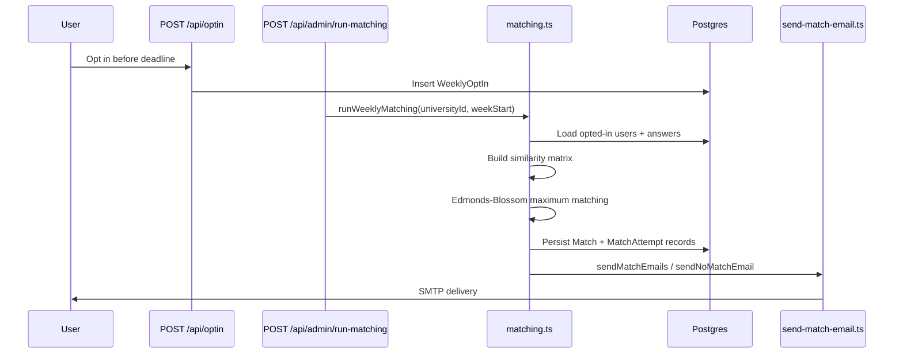
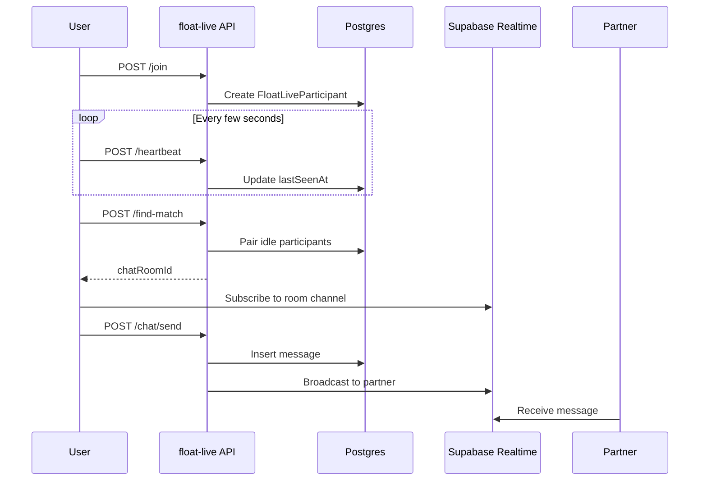

# Architecture

Technical reference for FloatDate. For a high-level overview, see the [README](../README.md).

---

## Repository Layout

```
floatdate/
├── src/
│   ├── app/              # Next.js App Router — pages + API routes
│   ├── components/       # Shared React components
│   ├── lib/              # Domain logic, auth, matching, email, tests
│   └── middleware.ts     # JWT route protection
├── prisma/
│   ├── schema.prisma     # Database schema
│   ├── migrations/       # SQL migrations (13)
│   ├── seed.ts           # Seeds questions from seed-data/
│   └── seed-data/        # questions.json (60 quiz items)
├── scripts/              # Operational CLI tools
│   └── dev/              # Email preview helpers (local only)
├── public/               # Static assets
└── docs/                 # Documentation
```

---

## Application Layers

### 1. Presentation (`src/app/`)

**Marketing & auth pages**

| Route | File | Purpose |
|-------|------|---------|
| `/` | `page.tsx` | Landing page |
| `/login`, `/signup` | `login/page.tsx`, `signup/page.tsx` | Authentication |
| `/verify-email` | `verify-email/page.tsx` | Post-signup verification prompt |
| `/forgot-password`, `/reset-password` | respective folders | Password recovery |
| `/about`, `/privacy`, `/universities` | respective folders | Static content |
| `/float-live-blog` | `float-live-blog/page.tsx` | Float Live marketing |

**Authenticated user pages** (protected by middleware)

| Route | Purpose |
|-------|---------|
| `/dashboard` | Opt-in, current match, feedback, profile |
| `/questions` | 60-question compatibility quiz |
| `/float-live` | Float Live lobby and session UI |
| `/float-live/chat/[roomId]` | Active chat room |
| `/float-pop-or-match` | Campus show application |

**Admin pages** (protected + `requireAdmin()`)

| Route | Purpose |
|-------|---------|
| `/admin` | Dashboard, matching trigger, user tools |
| `/admin/users` | User list and deletion |
| `/admin/verification-requests` | Document verification review |
| `/admin/show-applications` | Campus show applicant review |
| `/admin/feedbacks`, `/admin/reports` | Match feedback and Float Live reports |
| `/admin/float-live-chats` | Chat moderation |

**Dev-only** (returns 404 in production)

| Route | Purpose |
|-------|---------|
| `/design`, `/design/landing` | Figma capture frames for design export |

### 2. API Routes (`src/app/api/`)

69 route handlers grouped by domain:

| Group | Prefix | Count | Responsibility |
|-------|--------|-------|----------------|
| Auth | `/api/auth/*` | 8 | Signup, login, logout, verify, reset, me |
| Profile & quiz | `/api/profile`, `/api/answers`, `/api/questions` | 3 | User profile and quiz data |
| Matching | `/api/optin/*`, `/api/match/*` | 4 | Weekly opt-in and match retrieval |
| Float Live | `/api/float-live/*` | 21 | Sessions, matching, chat, presence, scheduled dates |
| Admin | `/api/admin/*` | 28 | Matching, users, moderation, previews |
| Public | `/api/universities`, `/api/university-requests`, `/api/referral/*` | 4 | University list, requests, referrals |
| Other | `/api/float-pop-or-match`, `/api/test-email` | 2 | Show applications, email test |

### 3. Domain Layer (`src/lib/`)

| Module | Responsibility |
|--------|----------------|
| `auth.ts` | JWT sessions, password hashing, impersonation cookies |
| `admin-auth.ts` | Admin allowlist check (`ADMIN_EMAILS`) |
| `admin-emails.ts` | Email allowlist parsing (server + client) |
| `db.ts` | Prisma singleton with `pg` pool |
| `matching.ts` | Compatibility scoring, blossom matching, explanations |
| `match-reasoning-v2.ts` | Grounded match explanation generator (feature-flagged) |
| `week-cycle.ts` | Week boundaries, opt-in deadline, matching time guard |
| `send-match-email.ts` | HTML email templates and dispatch |
| `email.ts` | Nodemailer transport configuration |
| `rate-limit.ts` | Upstash sliding-window rate limits |
| `supabase-client.ts` | Browser Supabase client (Realtime) |
| `supabase-admin.ts` | Service-role client (verification doc storage) |
| `float-live-*.ts` | Session timing, matching logic, presence |
| `webrtc-service.ts` | WebRTC audio calling (Float Live) |
| `referral.ts` | Referral code generation and validation |
| `sanitize-content.ts` | Chat message sanitization |
| `verification.ts` | Verification status constants |
| `guards.ts` | Feature gates (referral, show application deadline) |

### 4. Middleware (`src/middleware.ts`)

Protects routes starting with `/dashboard`, `/questions`, `/admin`, `/float-live`, `/float-pop-or-match`. Verifies `floatdate_session` JWT cookie; redirects to `/login` on failure.

Admin authorization is a second layer inside API routes and pages via `requireAdmin()`.

---

## Database Schema

PostgreSQL via Prisma. Key entity groups:

### Core

- **University** — slug, name, email domain, campuses
- **User** — profile, auth, verification status, referral code
- **Question** / **Answer** — 60-item quiz with weighted dimensions
- **WeeklyOptIn** — per-user per-week opt-in record
- **Match** — paired users, similarity score, explanation
- **MatchRun** / **MatchAttempt** — matching run audit trail and per-user outcomes
- **EmailLog** — email delivery status
- **PendingSignup** — pre-verification signup staging
- **Referral** — referrer → referred tracking
- **PasswordResetToken** — time-limited reset tokens

### Float Live

- **FloatLiveSession** — scheduled session windows
- **FloatLiveParticipant** — user presence, character, intention, status
- **FloatLiveChatRoom** — paired participants, email reveal flags
- **FloatLiveChatMessage** — message history
- **FloatLiveRoomParticipant** — per-room presence tracking
- **FloatLiveReport** — user reports
- **FloatLiveVoiceTranscript** — voice transcription storage
- **FloatLiveScheduledDate** — pre-scheduled blind dates

### Campus features

- **CampusShowApplication** — show application submissions
- **UniversityRequest** — requests for new university support

See [`prisma/schema.prisma`](../prisma/schema.prisma) for the full schema with indexes and constraints.

---

## Matching Pipeline



**Scoring dimensions:** attachment (2.0×), values (2.0×), lifestyle (1.5×), communication (1.5×), interests (1.0×).

**Constraints:** same university, compatible gender preferences, same city, minimum similarity threshold (0.35), no rematches within configurable window.

---

## Float Live Architecture



**WebRTC:** optional voice calling via `webrtc-service.ts` and `useWebRTC` hook; transcripts stored server-side.

**Cleanup:** daily Vercel cron calls `/api/admin/float-live/cleanup` to end stale sessions and archive data.

---

## Admin Impersonation

Admins can impersonate users for debugging:

1. `POST /api/admin/impersonate` sets `floatdate_impersonation` cookie (30-min TTL)
2. `getSessionContext()` in `auth.ts` returns `effectiveUserId` (target) and `actorUserId` (admin)
3. `POST /api/admin/impersonate/clear` removes impersonation cookie

All impersonation actions should be auditable via `admin-audit.ts` (partial coverage — some routes have TODO audit logs).

---

## External Dependencies

| Service | Used for | Config |
|---------|----------|--------|
| Supabase Postgres | Primary datastore | `DATABASE_URL` |
| Supabase Realtime | Float Live chat sync | `NEXT_PUBLIC_SUPABASE_URL`, `NEXT_PUBLIC_SUPABASE_ANON_KEY` |
| Supabase Storage | Verification document uploads | `SUPABASE_SERVICE_ROLE_KEY` |
| Upstash Redis | API rate limiting | `UPSTASH_REDIS_REST_URL`, `UPSTASH_REDIS_REST_TOKEN` |
| Gmail SMTP | Match notification emails | `EMAIL_USER`, `EMAIL_PASS` |
| PrivateMail SMTP | Verification and reset emails | `VERIFY_EMAIL_*` |

---

## Testing

Unit tests live in `src/lib/__tests__/` (7 files):

- `matching.test.ts` — compatibility scoring and pairing
- `match-explanation.test.ts` — explanation serialization
- `match-reasoning-v2.test.ts` — V2 reasoning generator
- `float-live-matching.test.ts` — Float Live pairing logic
- `float-live-scheduled.test.ts` — scheduled date logic
- `week-cycle.test.ts` — deadline and week boundary calculations
- `rate-limit.test.ts` — Upstash configuration validation

No E2E or API integration tests exist yet.
